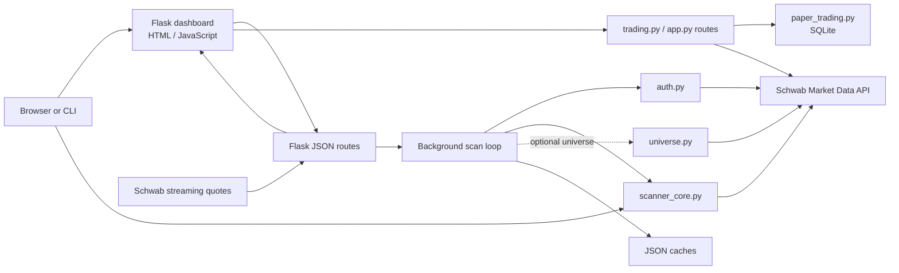

# Project Framework and Design

## Purpose

Schwab Options Scanner is a local Python application for scanning stock options and reviewing trades. It has two front ends that share the same scan engine:

- A Flask dashboard for live results, stock trends, charts, and order review.
- A command-line scanner that prints results and can write them to CSV.

Market data and account/trading access use Schwab's API through `schwab-py`. Paper trading is the default order mode. Live orders are available only when the separate Accounts and Trading app is configured and authorized.

## Technology framework

| Area | Technology | Responsibility |
|---|---|---|
| Runtime | Python | Scanner, Schwab API integration, data processing, and order workflows |
| Web server | Flask | Serves the dashboard and JSON endpoints |
| Browser UI | HTML, CSS, and vanilla JavaScript | Renders tables, charts, tabs, and trading forms; polls the server for updates |
| Market data | `schwab-py` | Option chains, candle history, quotes, and streaming stock/option quotes |
| Persistence | JSON files and SQLite | Scanner baselines/universe cache and local paper orders |
| Optional alerts | SMTP via `email_notify.py` | Sends email for newly qualifying contracts when enabled |
| Tests | Python `unittest` and JavaScript UI regression test | Checks scanner rules, auth, stream updates, trading flows, and dashboard behavior |

The dashboard binds to `127.0.0.1` by default. Its background scan runs on a daemon thread; Flask request handlers serve the latest in-memory snapshot while that scan proceeds.

## Architecture



### Main modules

- `app.py` owns the Flask application, in-memory result state, background scan lifecycle, quote-stream lifecycle, dashboard APIs, and order/position routes. It also joins live quote snapshots to scan results before returning them to the browser.
- `scanner_core.py` owns the reusable scanning logic: option-chain filtering, expiry and strike selection, candle retrieval, baselines, EMA and momentum calculations, stock trend/setup classification, and chart history.
- `options_scanner.py` is the CLI entry point. It loads the same credentials and scan engine as the dashboard, then prints and optionally exports results.
- `auth.py` creates separate Market Data and Trading clients. This keeps quote/chain access separate from account and order permissions.
- `universe.py` optionally builds the weekly-optionable stock universe from public symbol directories and Schwab expiration-chain checks. The resulting list is cached for reuse.
- `trading.py` builds and validates order payloads and price plans. `paper_trading.py` stores and processes simulated orders in SQLite.
- `config.py` loads environment settings and credentials. Secrets belong in environment variables or local token files and should not be committed.
- `templates/index.html` contains the dashboard markup, styles, and browser behavior. `static/` contains the installable web-app assets and network-only service worker.

## Scan and update flow

1. `app.py` starts `background_loop` in a daemon thread and serves the dashboard immediately.
2. The loop authorizes the Market Data client, loads the configured watchlist or builds the optional weekly universe, then scans each ticker with `scanner_core.run_pass_full`.
3. For each stock, the scanner requests the option chain, looks for the nearest future expiry, and independently selects call and put contracts that meet the configured price and spread filters. It also computes stock history, baselines, EMA trend, momentum, and opening-range setup context.
4. Each completed symbol is published into shared in-memory state. A failed option-chain response is recorded on that symbol while stock trend analysis continues where its required market history is available.
5. After a pass, the app subscribes to relevant equity and option streams and saves its baseline cache. A later pass starts after the configured interval.
6. The browser polls `/api/results`. That route combines the scan snapshot with the latest streamed quotes, and the Stock Trend and option tables are rerendered. The result response and browser request disable caching.
7. Chart history and option momentum use separate endpoints. Trading setup, order preparation, submit, cancellation, order history, and positions use `/api/trading/*` routes.

The configured scan interval controls the slower option-chain scan. The dashboard polls results more frequently so streamed quote changes can appear between scan passes. Stock metrics that depend on live quotes update during regular market hours when streaming is connected. Candle-derived values require sufficient completed regular-session history.

## Stock Trend design

The Stock Trend table is a stock-level view, even though its data is assembled alongside option scanning. It shows session setup, price versus EMA20, 10-minute momentum, and percentage moves over the session's defined time windows. Setup classification uses completed five-minute bars, EMA direction, VWAP, and opening-range breakout/retest conditions. Live equity quotes refresh the current-price-dependent values.

Rows represent scanned symbols, including symbols whose option-chain request failed. The Setup cell can surface a scan error; trend measurements still depend on Schwab returning the stock history needed to calculate them. Missing baselines or incomplete periods are represented as unavailable rather than inferred.

The normal mode reads `watchlist.txt`. `--weekly-universe` is a separate, larger scan mode and uses its own weekly trend view. It can take longer and makes more API calls, so it is opt-in.

## Order design and safety boundaries

- Paper mode is selected by default. Paper orders are local simulated records and do not call Schwab's order submission or cancellation API.
- Live order routes use the Trading client. The UI presents preparation/review before submission; server-side validation checks contract, quote, account, quantity, price, and position constraints.
- Closing a live position can require canceling active attached exits and confirming their cancellation before submitting a closing order.
- Market Data and Trading credentials and tokens are separate. The dashboard's scanner can operate without a Trading client, but order and account features require Trading authorization.

## Configuration and local data

Runtime settings are read from `.env` and `config.py`; `README.md` documents setup and supported flags. Common controls include the watchlist path, scan interval, callback URL, separate API credentials/token paths, weekly universe mode, and paper-trading database location.

The app keeps the active scan snapshot and quote stream in memory. Baseline and weekly-universe data use local JSON caches. Paper orders use SQLite. Schwab authorization tokens are local credentials and should be protected like secrets.

## Quality and change guidance

- Keep scan calculations in `scanner_core.py` so dashboard and CLI behavior remain aligned.
- Keep browser-only presentation and interaction in `templates/index.html`; keep server-side state and external API coordination in `app.py`.
- Preserve distinct Market Data and Trading client boundaries.
- Treat unavailable or stale external data explicitly; do not present missing values as zero or as a confirmed setup.
- Keep paper and live order paths clearly separated and validate order inputs on the server, even when the browser already validates them.
- Add focused tests alongside changes to scanner calculations, stream processing, order rules, or route behavior. The `tests/` directory is organized around these behaviors.

## Useful commands

```powershell
python app.py --interval 10
python app.py --weekly-universe --interval 60
python options_scanner.py
python options_scanner.py --watch 10
```

See `README.md` for installation, Schwab authorization, dashboard use, scanner filters, and trading workflow details.
